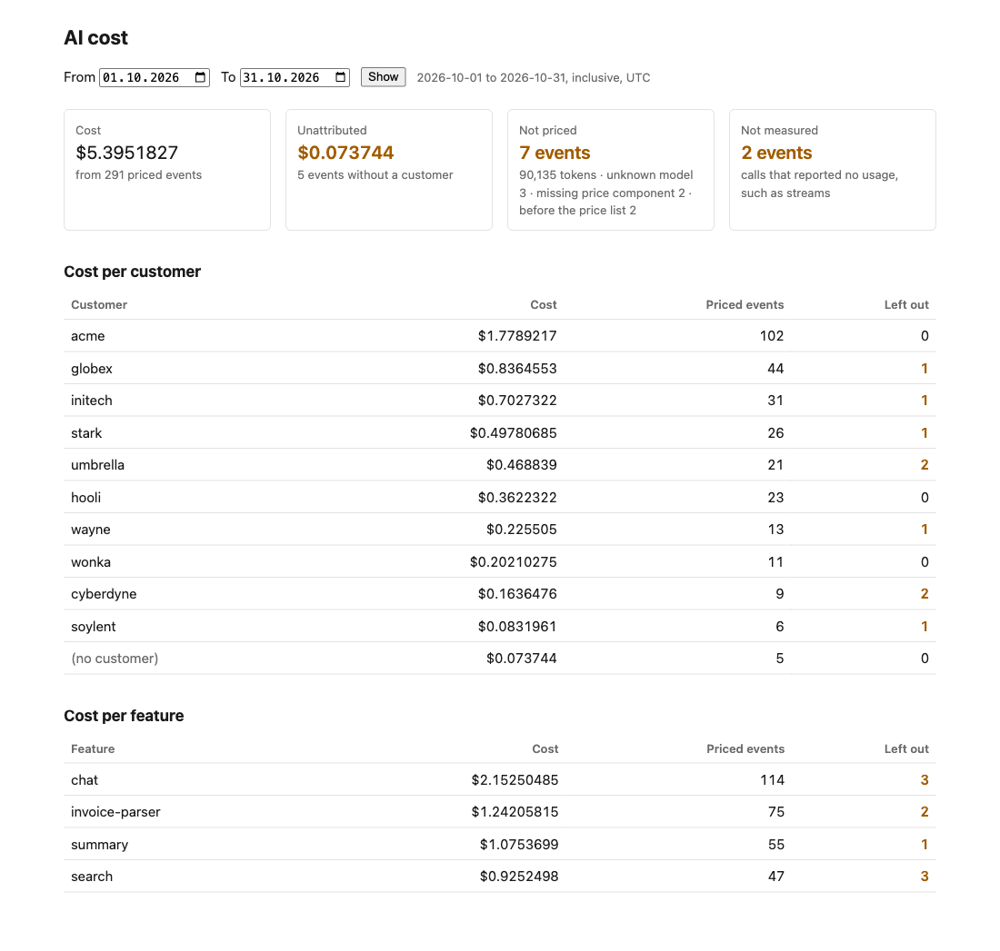

# AI Unit Economics

**See how much each of your customers costs you in AI.**

You pay Anthropic one bill — say $3,000 a month. But which customers ran that up? Is your
biggest customer profitable, or is one feature eating your margin? Anthropic can't tell you.
This tool can.

> **Early version (0.1.0-alpha).** Works with Anthropic (Claude) only. You run it on your own
> servers. It works end to end — and it tells you plainly what it can't do yet, see
> [Known limitations](#known-limitations).



## What you get

A dashboard that shows:

- **how much each customer cost you** in AI,
- **how much each feature cost you** (chat, search, summaries...),
- and — the part other tools skip — **what's missing from those numbers**:

| On the dashboard | What it means                                                      |
| ---------------- | ------------------------------------------------------------------ |
| **Cost**         | What we could price exactly                                        |
| **Unattributed** | AI calls you made without saying which customer they were for      |
| **Not priced**   | Calls we saw but couldn't price yet, and roughly how big they were |
| **Not measured** | Calls that came back without any usage numbers at all              |

If something is missing, you see it. It never quietly turns into $0.

## Why not just add it up yourself?

Because the details are easy to get wrong, and the mistakes are big:

- **Cache is counted differently by each provider.** Count it the wrong way and your numbers
  are off by 2× or more.
- **Prices aren't one simple rule.** Reading from cache costs a tenth of the normal price on
  most Claude models — but a twentieth on Opus 5.5 and a fortieth on Fable 5.1. Use the
  usual rule and you'll overcount the cached part 2–4×.
- **"Don't know" becomes $0.** An unknown model, a missing customer, a response without
  usage numbers — most tools count these as free. That always makes your bill look smaller
  than it is.

This tool prices to the fraction of a cent, uses the model that actually answered, keeps
dated prices, and shows every gap instead of hiding it.

## Try it in 2 minutes

You need [Docker](https://www.docker.com/). Then:

```sh
git clone https://github.com/kbuksakowski/ai-unit-economics.git
cd ai-unit-economics
docker compose --profile demo up
```

Open <http://localhost:3001> and log in with `demo` / `demo`. The demo has 300 example AI
calls from made-up customers, spread from 3 October 2026 to today — including a few with
deliberate problems, so you can see how gaps are shown. If the current month looks thin,
widen the date range. (The demo login and keys are public on purpose, and every port is open
to your own machine only.)

## Track your own AI calls

Add one wrapper around your Claude call. Your request still goes straight to Anthropic —
the tool only sees the model, the token counts and the customer and feature labels you add.
Never your prompts, the answers or your Anthropic key.

```ts
import Anthropic from '@anthropic-ai/sdk';
import { createClient } from '@ai-unit-economics/sdk';

const economics = createClient({
  apiKey: process.env.AIUE_INGESTION_KEY!,
  baseUrl: 'http://localhost:3000',
});
const anthropic = new Anthropic();

const message = await economics.track(
  () => anthropic.messages.create({ model: 'claude-haiku-4-5', max_tokens: 1024, messages }),
  { customerId: 'acme', feature: 'invoice-parser' },
);
```

You get back exactly what Anthropic returned. If this tool is down, your app keeps working —
your AI call never waits for it (those calls just aren't recorded). When the API isn't on
your own machine, put it and the dashboard behind HTTPS, for example a reverse proxy: the
keys travel with every request.

To try it against the demo with a real call, run
[`examples/track-anthropic`](examples/track-anthropic/index.ts) with your own Anthropic key and
the demo ingestion key `aiue_live_demo_local_only` (needs Node 24 and
`pnpm install && pnpm build` first); the call appears in the dashboard within seconds. SDK
details: [packages/sdk](packages/sdk).

## What it is not

It's not a proxy. It doesn't sit between you and Anthropic, doesn't hold your keys, doesn't
read your data, and never blocks or limits your calls.

## Known limitations

This is an early version. What it can't do yet:

- **Only Anthropic (Claude).** Calls to other providers pass through untouched and aren't
  counted yet.
- **Streaming responses aren't measured yet.** With `messages.create({ stream: true })` they
  show up as _not measured_, not as $0. `messages.stream()` isn't recorded at all yet.
- **"Fast mode" isn't priced yet.** It shows up as _not priced_ instead of a guess.
- **When Anthropic adds a new field to its responses, those calls show as _not priced_**
  until you update this tool, and calls recorded before the update stay _not priced_ for
  now. That's on purpose: a new field can change the price, and "don't know" is better than
  a quietly wrong number.
- **US-only processing, the priority tier, web search and code execution aren't priced
  yet.** They show up as _not priced_ instead of a guess.
- **Delivery is best-effort.** If this tool's API is down or slow, or your app exits mid-send,
  those calls are lost — your app itself is unaffected. In short-lived environments such as
  AWS Lambda, calls can be lost when the function freezes. Retries and buffering come later.
- **No user accounts.** The dashboard has one shared login.

## How it works

```
your app ──SDK──▶ ingestion API ──▶ usage events ──▶ normalise ──▶ price ──▶ cost facts ──▶ dashboard
               (raw usage only)      (as delivered)   (per provider)  (dated table)  (never updated in place)
```

- The SDK sends the provider's **raw** usage object; the server normalises it and keeps the
  original, so a normalisation bug can be corrected over history later. Re-running history
  automatically isn't built yet.
- Facts are **insert-only**. A correction is a new revision pointing at the one it replaces;
  "current" is derived.
- Prices are **versioned data**, pinned to a commit of the community price dataset and
  checked against Anthropic's published price list in tests.

Details: [docs/architecture.md](docs/architecture.md) and the decision records in
[docs/adr](docs/adr).

## Repository

```
apps/api               ingestion and analytics API (NestJS, TypeORM, MariaDB)
apps/dashboard         dashboard (Next.js)
packages/sdk           the Node.js SDK your application installs
packages/contracts     wire format shared by the SDK, the API and the dashboard
packages/core          framework-independent domain: money, normalisation, pricing
packages/pricing-data  dated provider prices, pinned to their source
examples/              a real Anthropic call, tracked end to end
```

## Development

Requirements: Node 24, pnpm 11, Docker.

```sh
pnpm install
docker compose up -d   # MariaDB on host port 3307
pnpm build             # tests read the built packages
pnpm test              # API tests recreate a separate test database
```

## Roadmap

- [x] **M1** SDK to ingestion to pricing to cost per customer, end to end
- [x] **M2** Completeness metrics: unattributed, not priced and not measured, surfaced
- [ ] **M3** Bill coverage: compare the attributed total with the provider's own cost report
- [ ] **M4** SDK reliability: buffering, retries, shutdown flush
- [ ] **M5** Streaming responses
- [ ] **M6** Full self-hosting guide and release process

Revenue and margin are deliberately **not** in the first release. Nobody computes a margin on
a number they do not trust.

## Contributing

Bug reports, questions and ideas are very welcome — please
[open an issue](https://github.com/kbuksakowski/ai-unit-economics/issues). Pull requests aren't
accepted for now; see [CONTRIBUTING.md](CONTRIBUTING.md).

## Licence

[Apache-2.0](LICENSE)
